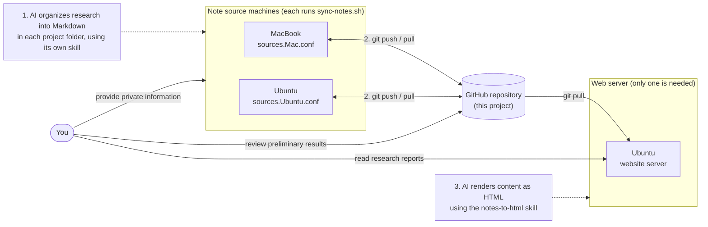

# NotesHub

**English** | [Traditional Chinese](README_cn.md)

Collect Markdown notes from many folders and machines into one GitHub repository with rsync and Git, then have Claude Code turn selected notes into standalone HTML pages with diagrams. Works on macOS and Ubuntu.

## How it works



| Stage | What it does | Part of this project? |
|---|---|---|
| 1 | Use Claude Code in each project folder to write research up as Markdown | No — your existing workflow |
| 2 | Mirror that Markdown into this repository with rsync, then commit and push | Yes — `src/sync-notes.sh` |
| 3 | Render selected Markdown files as diagram-rich HTML | Yes — `src/www.py` and the `notes-to-html` skill |

Stage 2 runs on every machine, each with its own `src/sources.<profile>.conf`. Stage 3 runs on any one machine: generated HTML is committed, so the others get it with `git pull` instead of paying to generate it again.

## Quick start

### 1. Prerequisites

- `git`, `rsync` and `python3` (standard library only): `brew install git rsync python3` or `sudo apt install -y git rsync python3`
- Push access to GitHub over [SSH](https://docs.github.com/en/authentication/connecting-to-github-with-ssh) or HTTPS with a [personal access token](https://docs.github.com/en/authentication/keeping-your-account-and-data-secure/managing-your-personal-access-tokens)
- Claude Code, for stage 3 only

### 2. Create your notes repository

Your notes are committed into this same repository and pushed automatically, so give it a **private** remote. Create an empty private repository on GitHub (for example `my-notes`).

> [!WARNING]
> Never run `src/sync-notes.sh` against a public remote, and never on a fork of this public repository. Every sync runs `git add -A` and pushes, so your notes go public, and so does each `src/sources.<profile>.conf`. Those files contain your local folder paths, and the file names can contain your machine's hostname. Check with `git remote -v` before your first sync.

Then:

```bash
git clone https://github.com/Suricatalu/NotesHub.git ~/notes
cd ~/notes
git remote set-url origin git@github.com:<your-account>/my-notes.git
git push -u origin HEAD
```

On each additional machine, just run `git clone git@github.com:<your-account>/my-notes.git ~/notes`.

### 3. Choose what this machine syncs

```bash
cd ~/notes
echo "laptop" > src/.sync-profile     # a name for this machine (not committed)
cp src/sources.conf src/sources.laptop.conf
```

Add one section per source folder to `src/sources.laptop.conf`:

```ini
[project-a]
src         = ~/work/project-a/docs
dst         = notes/project-a
include_ext = md
```

| Field | Required | Meaning |
|---|:---:|---|
| `src` | Yes | Source folder; `~` is expanded |
| `dst` | Yes | Target folder, relative to the repository root |
| `include_ext` | | Sync only these extensions, e.g. `md, txt` |
| `exclude_file` | | File names to skip, comma-separated |
| `exclude_dir` | | Subfolder names to skip, comma-separated |
| `recursive` | | `yes` (default) or `no` |

Put comments on their own line; a trailing `# ...` becomes part of the value. The profile name comes from `$SYNC_PROFILE`, then `src/.sync-profile`, then the short hostname.

### 4. Sync

```bash
cd ~/notes && bash src/sync-notes.sh
```

The script pulls, mirrors every `src` into its `dst`, then runs `git add -A`, commits and pushes (including your new `sources.laptop.conf`). It logs to `src/sync-notes.log`.

To sync every hour, add this line with `crontab -e`:

```cron
0 * * * * cd /path/to/notes && bash src/sync-notes.sh > /dev/null 2>&1
```

## Presentation layer

Rendering spends Claude tokens, so you trigger it by hand. `www.py` works out which pages need it, at no cost.

### 1. Define pages in `src/www.conf`

Each file matched by `main` becomes one page. `refs` are extra context for rendering and never become pages.

```ini
[auth-design]
title = Authentication design
group = Architecture
order = 10
main  = notes/auth/overview.md
main += notes/auth/token-refresh.md
refs  = notes/auth/*.md
note  = Cover the trust model before the API surface.
```

This produces `www/pages/auth-design/overview.html` and `www/pages/auth-design/token-refresh.html`.

| Field | Required | Meaning |
|---|:---:|---|
| `title` | Yes | Sidebar label. With several `main` files, each page shows `title · <that file's H1>` |
| `main` | Yes | Repository-relative path or glob (`*`, `**`); add more with `main +=` |
| `refs` | | Reference files, same syntax as `main` |
| `group` / `order` | | Sidebar group, and position within it (default `50`) |
| `note` | | Extra instruction to the skill, for every page in the section |
| `type` / `href` | | `type = link` plus `href` adds existing hand-written HTML to the sidebar without generating it |

A page ID is `<section>/<file name>`. Each page keeps the heading structure of its `main` file exactly; the skill visualizes the content under each heading but never adds, removes or reorders headings.

### 2. Check status

```bash
python3 src/www.py status
```

```
GROUP         PAGE                       STATUS     DETAIL
────────────  ─────────────────────────  ─────────  ─────────────────────────────────────────────────
Architecture  auth-design/overview       OK         1 main file + 4 ref(s), 2026-08-13T18:20:11+08:00
Architecture  auth-design/token-refresh  NEW        no manifest record
Operations    log-rotation/intro         STALE:src  main 1 file(s) content changed

2 page(s) need generation; 0 page(s) need manual attention.
```

| Status | Meaning |
|---|---|
| `OK` | Up to date; skipped |
| `NEW` | Never generated |
| `STALE:src` / `STALE:spec` / `STALE:skill` | The source files / the page's `www.conf` entry / the skill changed since generation |
| `DIRTY` | The HTML was edited by hand; Claude asks before overwriting it |
| `MISSING:src` | A path in `www.conf` does not exist, a glob matched nothing, or two `main` files share a name |
| `ORPHAN` | A file in `www/pages/` that `www.conf` no longer defines; reported, never deleted |
| `LINK` | A `type = link` entry |

Status is based on SHA-256 content hashes stored in `www/manifest.json`, which is committed so every machine sees the same state.

### 3. Ask Claude Code to generate pages

Run `claude` in the repository root. Don't run `/init`: the committed `CLAUDE.md` and `.claude/skills/notes-to-html/` already configure it, and `/init` would overwrite `CLAUDE.md`. Name the skill in any request that creates or changes HTML:

| Goal | Prompt |
|---|---|
| Everything pending | `Using the notes-to-html skill, generate or update every NEW and STALE page.` |
| One page | `Using the notes-to-html skill, generate the auth-design/overview page.` |
| Look only | `Run python3 src/www.py status and tell me which pages need regeneration; don't generate anything yet.` |
| Accept a comment-only skill edit | `I only changed skill comments. Run python3 src/www.py accept-skill; don't regenerate pages.` |

You can also invoke the skill directly with `/notes-to-html`.

Cost grows with the number of `main` files, so generate one page first to check the layout. Changing a section's `note` marks all of its pages stale; changing any file in the skill marks every page stale.

### 4. Browse

```bash
python3 -m http.server 8080    # from the repository root, then open http://localhost:8080/www/
```

For a permanent server, set `root` in [docs/nginx-noteshub.conf](docs/nginx-noteshub.conf) to your clone's path, then:

```bash
sudo cp docs/nginx-noteshub.conf /etc/nginx/sites-available/noteshub
sudo ln -sf /etc/nginx/sites-available/noteshub /etc/nginx/sites-enabled/noteshub
sudo nginx -t && sudo systemctl reload nginx    # then open http://localhost:8081/
```

> The nginx site listens on every interface, so anyone on your network can read the whole repository. For local-only access, change `listen 8081;` to `listen 127.0.0.1:8081;` and remove the IPv6 line.

### Other commands

```bash
python3 src/www.py status --json          # machine-readable, for Claude
python3 src/www.py status --stale-only    # only pages that need work
python3 src/www.py plan <page-id|section> # a page's main / refs / note / output path
python3 src/www.py commit <page-id|section|--all>  # record hashes after generating
python3 src/www.py accept-skill           # accept a skill change without regenerating
python3 src/www.py nav                    # rebuild www/index.html
```

Layout rules live in [the notes-to-html skill](.claude/skills/notes-to-html/SKILL.md); design rationale is in [docs/www-plan.md](docs/www-plan.md).

## Repository layout

```
NotesHub/
├── CLAUDE.md                      # Rules Claude Code loads automatically
├── src/
│   ├── sync-notes.sh              # Stage 2: rsync, commit, push
│   ├── sources.conf               # Template for sources.<profile>.conf
│   ├── www.conf                   # Stage 3: page definitions
│   └── www.py                     # Stage 3: status, manifest, sidebar
├── .claude/skills/notes-to-html/  # Stage 3: layout rules, page template, validator
├── docs/                          # Design notes and nginx config
├── www/                           # Generated pages (created on first use)
└── <dst folders>/                 # Your synced notes
```

## Cautions

- rsync runs with `--delete`: a file removed from a source folder is removed from its `dst` as well. Point each `dst` only at a folder dedicated to that source.
- Synced folders are read-only mirrors. Edit the original source; changes made here are overwritten on the next sync.
- Everything in the repository, synced notes and `www/` included, is committed and pushed automatically. Keep the GitHub repository private unless every synced folder is safe to publish.

## License

MIT — see [LICENSE](LICENSE).
