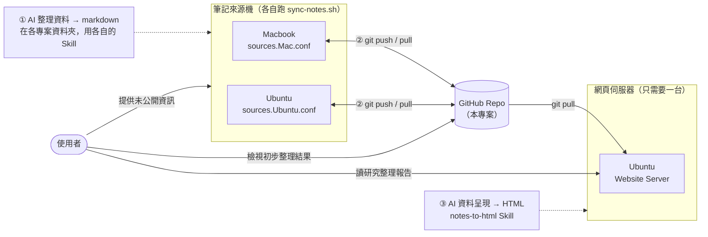

# NotesHub

[English](README.md) | **繁體中文**

用 rsync + git 把**散落在多台電腦、多個資料夾**的 Markdown 筆記集中到同一個 GitHub repo，再用 Claude Code 把選定的筆記轉成帶架構圖與流程圖的單檔 HTML。支援 macOS 與 Ubuntu。

## 運作原理



| | 做什麼 | 屬於本專案？ |
|---|---|---|
| ① | 在各專案資料夾裡用 Claude Code 把研究過程整理成 md | ✘ 你原有的工作流 |
| ② | rsync 把那些 md 鏡像進這個 repo，再 commit、push | ✔ `src/sync-notes.sh` |
| ③ | 把選定的 md 轉成帶架構圖的 HTML | ✔ `src/www.py` + `notes-to-html` Skill |

第 ② 段每台電腦都跑，各自有一份 `src/sources.<profile>.conf`。第 ③ 段只需要一台跑：產出的 HTML 進版控，其他台 `git pull` 就有，不必再花一次 token。

## 快速開始

### 1. 準備

- `git`、`rsync`、`python3`（只用標準庫）：`brew install git rsync python3` 或 `sudo apt install -y git rsync python3`
- 能 push 到 GitHub：[SSH](https://docs.github.com/en/authentication/connecting-to-github-with-ssh) 或 HTTPS + [Personal Access Token](https://docs.github.com/en/authentication/keeping-your-account-and-data-secure/managing-your-personal-access-tokens)
- Claude Code，只有第 ③ 段需要

### 2. 建立你的筆記 repo

筆記會 commit 進這個 repo 並自動 push，所以 remote 要設成**私有** repo。先在 GitHub 建一個空的私有 repo（例如 `my-notes`）。

> [!WARNING]
> 絕對不要讓 `src/sync-notes.sh` 對著公開的 remote 跑，也不要在這個公開 repo 的 fork 上跑。每次同步都會 `git add -A` 再 push，除了筆記會被公開，每份 `src/sources.<profile>.conf` 也會一起推上去：裡面有你本機的資料夾路徑，檔名也可能帶著主機名稱。第一次同步前先用 `git remote -v` 確認。

然後：

```bash
git clone https://github.com/<owner>/NotesHub.git ~/notes
cd ~/notes
git remote set-url origin git@github.com:<你的帳號>/my-notes.git
git push -u origin HEAD
```

其他電腦只要 `git clone git@github.com:<你的帳號>/my-notes.git ~/notes`。

### 3. 設定這台電腦要同步什麼

```bash
cd ~/notes
echo "laptop" > src/.sync-profile     # 這台電腦的名字，自己取（不進版控）
cp src/sources.conf src/sources.laptop.conf
```

在 `src/sources.laptop.conf` 裡，每個來源資料夾寫一個 section：

```ini
[project-a]
src         = ~/work/project-a/docs
dst         = notes/project-a
include_ext = md
```

| 欄位 | 必填 | 說明 |
|---|:---:|---|
| `src` | ✔ | 來源資料夾，支援 `~` |
| `dst` | ✔ | 目標資料夾，repo 相對路徑 |
| `include_ext` | | 只同步這些副檔名，例如 `md, txt` |
| `exclude_file` | | 排除的檔名，逗號分隔 |
| `exclude_dir` | | 排除的子資料夾名，逗號分隔 |
| `recursive` | | `yes`（預設）或 `no` |

註解要獨立一行；寫在值後面的 `# ...` 會被當成值的一部分。profile 名稱的決定順序：`$SYNC_PROFILE` → `src/.sync-profile` → 主機名稱。

### 4. 同步

```bash
cd ~/notes && bash src/sync-notes.sh
```

腳本會先 pull，把每個 `src` 鏡像到對應的 `dst`，再 `git add -A` → commit → push（剛建的 `sources.laptop.conf` 也會一起推上去）。log 在 `src/sync-notes.log`。

要每小時自動同步，用 `crontab -e` 加上：

```cron
0 * * * * cd /path/to/notes && bash src/sync-notes.sh > /dev/null 2>&1
```

## 呈現層

轉譯要花 Claude 的 token，所以是手動觸發；哪些頁面該重轉由 `www.py` 零成本算出來。

### 1. 在 `src/www.conf` 定義頁面

`main` 命中幾份 md 就產出幾頁；`refs` 只是轉譯時的參考資料，不會自己變成一頁。

```ini
[auth-design]
title = 認證機制設計
group = 架構設計
order = 10
main  = notes/auth/overview.md
main += notes/auth/token-refresh.md
refs  = notes/auth/*.md
note  = 先講信任模型再講 API，不用逐一列出 endpoint
```

這個 section 會產出 `www/pages/auth-design/overview.html` 與 `www/pages/auth-design/token-refresh.html`。

| 欄位 | 必填 | 說明 |
|---|:---:|---|
| `title` | ✔ | 選單顯示名。多份 `main` 時每頁顯示「`title` · 該 md 的 H1」 |
| `main` | ✔ | repo 相對路徑或 glob（`*`、`**`），用 `main +=` 累加 |
| `refs` | | 參考資料，寫法同 `main` |
| `group` / `order` | | 選單分組與組內排序（預設 `50`） |
| `note` | | 給 Skill 的額外指示，套用到該 section 的每一頁 |
| `type` / `href` | | `type = link` 加 `href`，把既有的手工 HTML 掛進選單，不參與生成 |

頁面 id 是 `<section>/<md 檔名>`。每一頁的章節架構完全沿用它的 `main`：Skill 只在各章節底下做視覺轉譯，不增刪、不重排章節。

### 2. 看哪些頁面需要處理

```bash
python3 src/www.py status
```

```
GROUP     PAGE                       STATUS     DETAIL
────────  ─────────────────────────  ─────────  ─────────────────────────────────────────────────
架構設計  auth-design/overview       OK         1 main file + 4 ref(s), 2026-08-13T18:20:11+08:00
架構設計  auth-design/token-refresh  NEW        no manifest record
系統維運  log-rotation/intro         STALE:src  main 1 file(s) content changed

2 page(s) need generation; 0 page(s) need manual attention.
```

| 狀態 | 意思 |
|---|---|
| `OK` | 已是最新，跳過 |
| `NEW` | 還沒生成過 |
| `STALE:src` / `STALE:spec` / `STALE:skill` | 生成後，來源 md／該頁在 `www.conf` 的設定／Skill 變了 |
| `DIRTY` | HTML 被手動改過，Claude 會先問你再覆蓋 |
| `MISSING:src` | `www.conf` 裡的路徑不存在、glob 零命中，或兩份 `main` 同檔名 |
| `ORPHAN` | `www/pages/` 有檔案但 `www.conf` 沒定義；只回報，不會刪 |
| `LINK` | `type = link` 的項目 |

判斷依據是存在 `www/manifest.json` 的 SHA-256 內容雜湊；manifest 進版控，所以每台機器看到的狀態一致。

### 3. 請 Claude Code 生成

在 repo 根目錄開 `claude`。不要跑 `/init`：版控裡的 `CLAUDE.md` 與 `.claude/skills/notes-to-html/` 已經設定好，`/init` 只會蓋掉 `CLAUDE.md`。凡是會產生或修改 HTML 的請求，都要講出 Skill 的名字：

| 你想做什麼 | 直接這樣打 |
|---|---|
| 做完所有待處理的頁面 | `依 notes-to-html Skill，把所有 NEW 和 STALE 的頁面生成或更新` |
| 只做某一頁 | `用 notes-to-html Skill 生成 auth-design/overview 這一頁` |
| 只看不做 | `跑 python3 src/www.py status，告訴我哪些頁面需要重新生成，先不要開始生成` |
| Skill 只改了註解 | `我只改了 Skill 的註解，跑 python3 src/www.py accept-skill 就好，不用重新生成` |

也可以用 `/notes-to-html` 斜線指令直接叫出 Skill。

費用跟 `main` 的份數成正比，建議第一次先做一頁看版型。改某個 section 的 `note` 會讓它所有頁面過期；改 Skill 裡任何檔案會讓全部頁面過期。

### 4. 瀏覽

```bash
python3 -m http.server 8080    # 在 repo 根目錄執行，然後開 http://localhost:8080/www/
```

要常駐的話，先把 [docs/nginx-noteshub.conf](docs/nginx-noteshub.conf) 的 `root` 改成你 clone 的路徑，再：

```bash
sudo cp docs/nginx-noteshub.conf /etc/nginx/sites-available/noteshub
sudo ln -sf /etc/nginx/sites-available/noteshub /etc/nginx/sites-enabled/noteshub
sudo nginx -t && sudo systemctl reload nginx    # 然後開 http://localhost:8081/
```

> nginx 站台綁在全介面，同網段的機器都讀得到整個 repo。只想本機看的話，把 `listen 8081;` 改成 `listen 127.0.0.1:8081;` 並拿掉 IPv6 那行。

### 其他指令

```bash
python3 src/www.py status --json          # 給 Claude 吃的結構化輸出
python3 src/www.py status --stale-only    # 只列需要處理的
python3 src/www.py plan <頁面 id|section>  # 印出該頁的 main / refs / note / 產出路徑
python3 src/www.py commit <頁面 id|section|--all>  # 生成完回填 manifest
python3 src/www.py accept-skill           # 接受 Skill 變更，不觸發重生成
python3 src/www.py nav                    # 重新生成 www/index.html
```

版型規範在 [notes-to-html Skill](.claude/skills/notes-to-html/SKILL.md)，設計取捨記錄在 [docs/www-plan.md](docs/www-plan.md)（英文）。

## 目錄結構

```
NotesHub/
├── CLAUDE.md                      # Claude Code 自動載入的專案規則
├── src/
│   ├── sync-notes.sh              # 第 ② 段：rsync、commit、push
│   ├── sources.conf               # sources.<profile>.conf 的範本
│   ├── www.conf                   # 第 ③ 段：頁面定義
│   └── www.py                     # 第 ③ 段：狀態判斷、manifest、選單
├── .claude/skills/notes-to-html/  # 第 ③ 段：版型規範、頁面骨架、驗證器
├── docs/                          # 設計記錄與 nginx 設定
├── www/                           # 生成的頁面（第一次使用時建立）
└── <dst 資料夾>/                   # 同步進來的筆記
```

## 注意事項

- rsync 使用 `--delete`：來源刪掉的檔案，`dst` 裡也會被刪。每個 `dst` 只指向專屬於該來源的資料夾。
- 同步進來的資料夾是唯讀鏡像，在這裡改會被下次同步蓋掉，要改請改原始來源。
- repo 裡的所有東西，包括同步進來的筆記與 `www/`，都會自動 commit 並 push。除非每個同步資料夾都能公開，否則 GitHub repo 請維持私有。

## 授權

MIT — 見 [LICENSE](LICENSE)。
